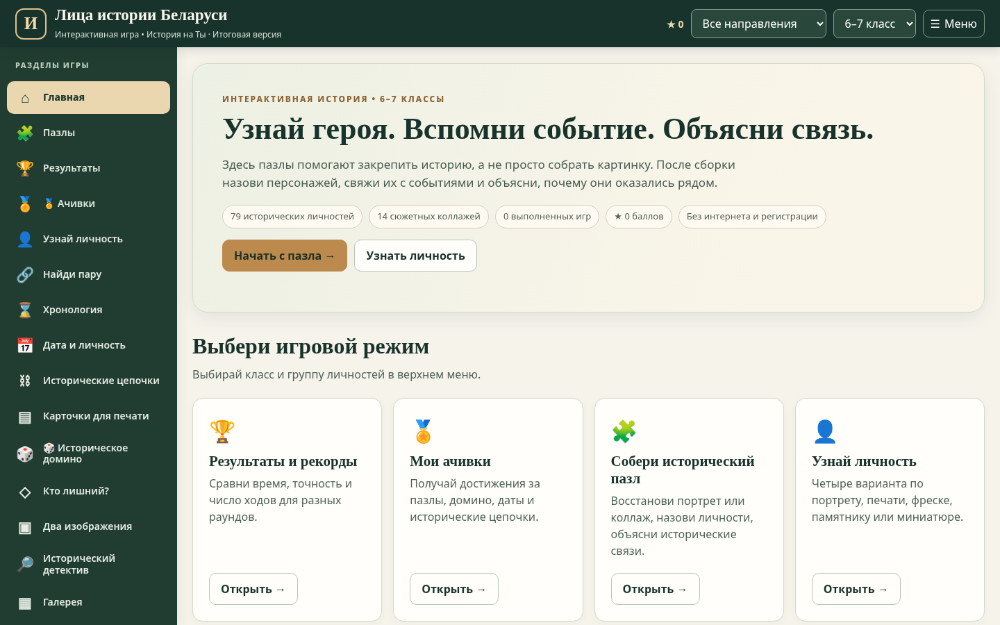

# Лица истории Беларуси — «История на Ты»

**Интерактивная учебная игра по истории Беларуси для 6–7 классов.**

Игра предназначена для закрепления исторических личностей, событий, дат и причинно-следственных связей. Работает в браузере на компьютере, планшете и смартфоне.

## Как открыть

- **Онлайн:** после настройки GitHub Pages игра будет доступна по адресу `https://ВАШ-ЛОГИН.github.io/litsa-istorii-belarusi/`.
- **Без интернета:** скачайте `index.html` на устройство и откройте его двойным щелчком или через браузер. Все основные изображения встроены в файл.

## Что есть в игре

- Исторические пазлы и коллажи: имя открывается только после сборки и ответа.
- «Историческое домино», включая смешанные длинные наборы.
- «Тренировка» с подсказками и «Соревнование» с результатами.
- Викторины по изображениям, сопоставление персоналий и фактов.
- Хронология, задания «Дата и личность», исторические цепочки.
- Карточки для просмотра и печати, достижения (ачивки).
- Боковое сворачиваемое меню и мобильное отображение.

**Важно:** результаты и достижения сохраняются в локальном хранилище браузера на конкретном устройстве и в рамках соответствующего адреса сайта. Между разными устройствами они автоматически не синхронизируются. Не следует использовать локальный рейтинг как защищенную систему оценивания.

## Публикация на GitHub Pages

Пошаговая инструкция для Windows и GitHub Desktop находится в файле [GITHUB_PAGES_ИНСТРУКЦИЯ.md](GITHUB_PAGES_ИНСТРУКЦИЯ.md).

**Кратко:** загрузите содержимое этой папки в корень репозитория, затем в `Settings → Pages` выберите `Deploy from a branch`, ветку `main` и папку `/(root)`.

## Файлы

| Файл | Назначение |
|---|---|
| `index.html` | Вся автономная игра, без отдельных библиотек или сборки |
| `.nojekyll` | Отключает обработку через Jekyll на GitHub Pages |
| `images/` | Только изображения предварительного просмотра README |
| `GITHUB_PAGES_ИНСТРУКЦИЯ.md` | Пошаговая инструкция для начинающего |
| `ИСТОЧНИКИ_И_ПРАВА.md` | Информация об иллюстрациях и условиях открытой публикации |

## Учебные источники

При составлении игровых заданий использованы материалы учебников по истории Беларуси для 6 класса (2023) и 7 класса (2017). Изображения могут быть прижизненными, позднейшими художественными, памятниками, печатями, фресками и летописными миниатюрами: в ряде случаев они отражают исторический образ, а не документально достоверный внешний вид личности.

## Авторские права

Исторические изображения, портреты и фотографии могут иметь различные условия использования. **До публичной публикации проверьте право размещения каждой иллюстрации и укажите атрибуцию там, где это требуется.** Данный комплект не содержит автоматически присвоенной открытой лицензии. См. [ИСТОЧНИКИ_И_ПРАВА.md](ИСТОЧНИКИ_И_ПРАВА.md).
